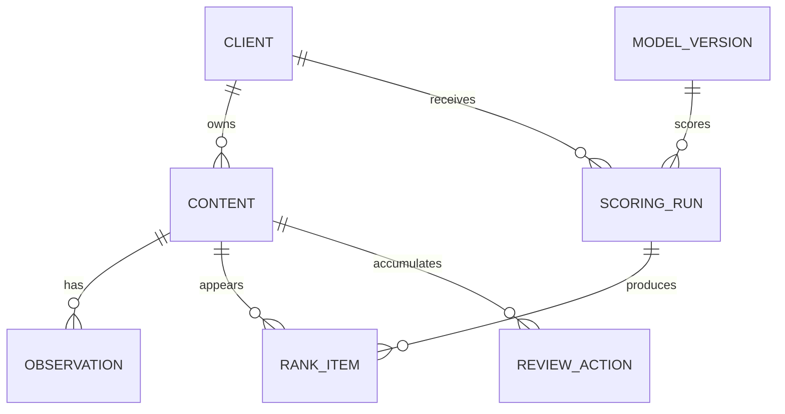

# PostgreSQL design

Use composite client/content foreign keys on observations, ranks and actions. Observation PK adds snapshot ID. Model version stores registry URI, artifact digest and feature schema. Run key is unique on client, input digest, transform revision and model digest. Rank item PK is run/content with unique (run, position), raw score, reason codes and observed evidence. Client points to its published run via a same-client FK. Lock the client on publish and reject older cutoffs. Pin list pagination to run ID.

Store review status and optimistic version separately from ranking data on content. Append each action with immutable UUID, actor, UTC time, prior/new status, decision, note and unique client/request key. In one transaction check version, insert event and update content. Index history on client/content/time/action ID. Preserve past observations and runs across refreshes.
