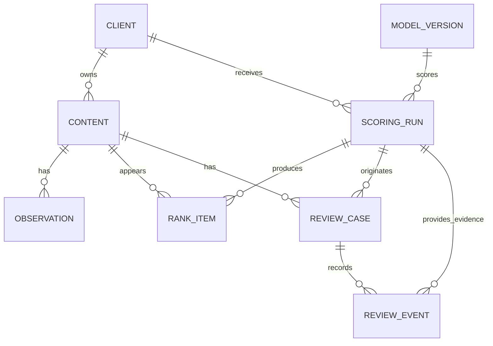

# PostgreSQL design

### Observations and ranked runs

Use composite client/content foreign keys on observations, ranks and cases. Observation PK adds snapshot ID. Preserve observation cutoff, source release and snapshot identity, input digest and each metric's definition, unit and window bounds. The input digest covers the snapshot manifest, including its cutoff and source checksums. Published ranks cite the observation that supplied the evidence. Persist immutable observations and runs across refreshes.

Model version stores the immutable model ID, artifact SHA-256 and feature schema version. Registry URI and version are nullable for local artifacts. Run metadata includes run ID, snapshot ID, input digest, observation cutoff, transform revision, model ID, status, counts and start, finish and publication timestamps. Run key is unique on client, input digest, transform revision and model digest. Rank item PK is run/content with unique (run, position), raw score, reason codes and observed evidence. Client points to its published run via a same-client FK. Lock the client on publish and reject older cutoffs. Pin list pagination to run ID.

Flyway owns the schema. The Python publisher writes only ingestion and scoring data and advances the publication pointer atomically. Spring owns review case and event writes.

### Review cases and audit

Persist each case under client, content and issue type with its own case ID, opening run and cutoff, status and optimistic version. Enforce at most one active case per client/content/issue and a unique opening cutoff for that key. `OPEN`, `IN_REVIEW`, `ACTION_TAKEN` and `DEFERRED` are active. `RESOLVED` and `NO_ACTION` are terminal.

Derive review state when reading an eligible item in the current published queue. V1 treats publication in the eligible decline-priority queue as qualification for the `DECLINE_PRIORITY` issue. Carry an active case forward while the item qualifies. If the item drops out, leave the case accessible in history without changing its state. On terminal transition record the client's current published observation cutoff under the same client lock used for publication. A qualifying item with a strictly newer observation cutoff can appear as a new `OPEN` candidate. A rerun at the same or an earlier cutoff keeps the terminal status and creates zero cases. History preserves each case and its event sequence when a new candidate appears.

Persist a virtual candidate only on its first valid transition. In one Spring transaction, lock the client and resolve request-key replay before checking versions and transitions. Validate the candidate run against the current publication, create one case in version 0, append `CASE_OPENED`, append the transition event and update status and version. Use the same version check and audit append for subsequent mutations. A stale candidate or concurrent version returns conflict. This keeps reruns and scoring publication free of review-state writes.

Persist each append-only event with immutable UUID, case ID and resulting version, actor, UTC event time, type, prior/new status, reviewed run and observation IDs, optional analyst decision and note. Record the independently scoped request key and request fingerprint for analyst writes so retries replay the original result and different requests under the same client/key conflict. Index history on client/content/time/event ID. An `act` event's reviewed observation and event time anchor follow-up comparisons.
