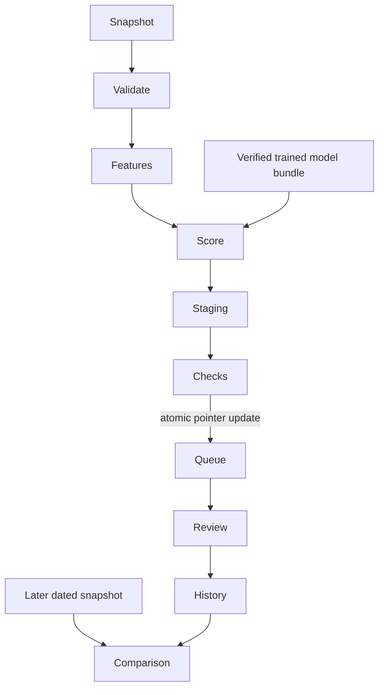

# Batch and review flow

A failed validation or staging check records a failed run. Readers retain the previous published run. A follow-up comparison requires comparable dated observations of the same item and a post-action measurement window. The dashboard shows unavailable when a single snapshot exists. [Follow-up contract](API_CONTRACT.md)
