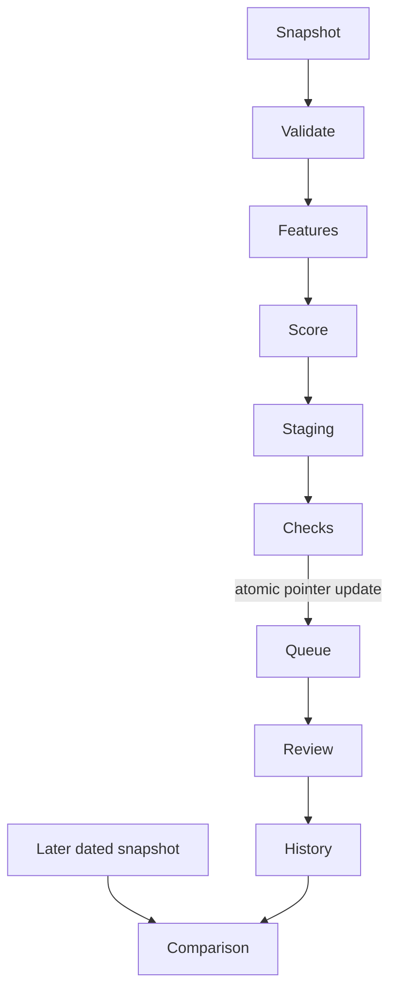

# Batch and review flow

A failed validation or staging check records a failed run. Readers retain the previous published run. Historical comparisons require distinct dated observations of the same item.
